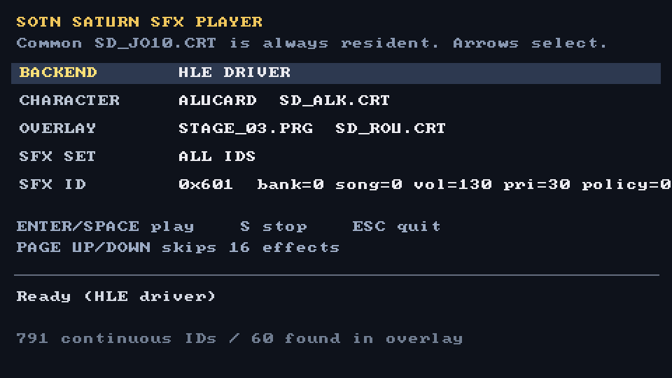

# Saturn Sound Player



This is an offline player for SEGA's sound library used in Saturn games.
Currently Castlevania: Symphony of the Night and Scorcher have explicit
support. Ymir is used for the 68k and SCSP emulation. The player can
be run in LLE or HLE mode. In LLE mode the game's bundled 68k program is
emulated, while in HLE mode Sega's sound driver is reimplemented in C++ and
Ymir continues to emulate the SCSP. Game assets are not included and the user
must provide their own files.

## Current Support

- SOTN: in-game sequenced sound effects.
- Scorcher: MUS songs.

### Supported revisions

- Japanese retail SOTN `0.BIN`, 312672 bytes, SHA-256
  `f00350c56489ca347450263cc697fdbd40940b2fab86e39c580fb73627a5d191`,
  containing the Sega `Ver-2.10-L` sound driver.
- USA retail Scorcher MUS files containing the Sega
  `Ver1.31 95/06/20` sound driver. The tested `LEVEL1.MUS` is 387268 bytes
  with SHA-256
  `30a5d9ea6862e222dad70990968f2090d82270c963cf920d562ac3acf18f6ad3`.

Other regions and revisions are not currently verified.

## Architecture

```text
src/core           Shared WAV and application support
saturn-sndlib      Generic Sega driver/HLE/SCSP functionality
src/games/sotn     SOTN file tables, overlays, and SDL interface
src/games/scorcher Scorcher MUS container and startup policy
research/scorcher  Reproducible Scorcher disassembly configurations
```

## Build

The project requires CMake 3.28 or newer and a C++20 compiler. SDL3 is
optional, but required for the interactive SOTN player.

Initialize the nested dependencies when cloning the repository:

```sh
git submodule update --init --recursive
```

All further commands assume these shell variables:

```sh
PLAYER=./build/saturn-sfx
SOTN_GAME='/path/to/extracted/sotn'
SCORCHER_MUSIC='/path/to/SCORSAT/GAME/SATMUSIC'
```

`$SOTN_GAME` must contain the main executable, sound-data directory, and stage
overlays in this layout:

```text
0.BIN
SD/
STAGE_02.PRG
STPROLO.PRG
...
```

If Ymir is checked out at ./ymir:

```sh
cmake -S . -B build
cmake --build build -j8
```

With Ymir elsewhere:

```sh
cmake -S . -B build -DYMIR_DIR=/path/to/Ymir
cmake --build build -j8
```

SDL3 must be detected during configuration to build the interactive SOTN player.

## Start the interactive SOTN player

Using the original 68000 driver:

```sh
$PLAYER play --game-bin "$SOTN_GAME/0.BIN"
```

Using the HLE backend:

```sh
$PLAYER play \
  --backend hle \
  --game-bin "$SOTN_GAME/0.BIN"
```

The player keeps SOTN’s common sound package resident and lets you select the
character, stage, and SFX ID. Stage-specific SFX IDs only produce the correct
sound when the corresponding stage package is loaded.

To save the initial player screen as a BMP and exit:

## Render one SOTN SFX

The selected CRT must contain the sound data expected by that SFX ID:

```sh
$PLAYER render \
  --game-bin "$SOTN_GAME/0.BIN" \
  --crt "$SOTN_GAME/SD/SD_ALK.CRT" \
  --sfx 0x7A1 \
  --seconds 5 \
  --output /tmp/sotn-7a1.wav
```

Using HLE:

```sh
$PLAYER render \
  --backend hle \
  --game-bin "$SOTN_GAME/0.BIN" \
  --crt "$SOTN_GAME/SD/SD_ALK.CRT" \
  --sfx 0x7A1 \
  --seconds 5 \
  --output /tmp/sotn-7a1-hle.wav
```

## Render a Scorcher song

Using Scorcher’s original 68000 driver:

```sh
$PLAYER scorcher \
  --backend lle \
  --mus "$SCORCHER_MUSIC/LEVEL1.MUS" \
  --seconds 30 \
  --output /tmp/scorcher-level1-lle.wav
```

Using HLE:

```sh
$PLAYER scorcher \
  --backend hle \
  --mus "$SCORCHER_MUSIC/LEVEL1.MUS" \
  --seconds 30 \
  --output /tmp/scorcher-level1-hle.wav
```

## Run the standalone Mozart smoke test

This test creates a synthetic sequence and sine-wave tone bank, packs them
into the supported file format, reloads and round-trips the package, and
renders it through HLE:

```sh
./build/saturn-sndlib/saturn-sndlib-mozart-smoke \
  /tmp/saturn-mozart.wav
```

Then listen to it:

```sh
afplay /tmp/saturn-mozart.wav
```

## Run the self-contained test suite

Configure with data-free game tests enabled. Retail-data tests are added only
when their corresponding directories are supplied:

```sh
cmake -S . -B build \
  -DSATURN_PLAYER_BUILD_GAME_TESTS=ON
```

```sh
cmake --build build -j8
```

```sh
ctest \
  --test-dir build \
  --output-on-failure \
  -j8
```

These tests do not require SOTN or Scorcher files.

## Run the SOTN LLE/HLE oracles

Configure with a supported extracted game directory:

```sh
cmake -S . -B build \
  -DSATURN_PLAYER_BUILD_GAME_TESTS=ON \
  -DSOTN_GAME_DIR="$SOTN_GAME"
```

```sh
cmake --build build -j8
```

Run the SOTN corpus tests:

```sh
ctest \
  --test-dir build \
  --output-on-failure \
  -R 'sound-package-roundtrip|overlay-pcm-lle-oracle|sequence|tone|hle-pcm'
```

## Run the Scorcher LLE/HLE oracle

Configure with the directory containing all seven retail MUS files:

```sh
cmake -S . -B build \
  -DSATURN_PLAYER_BUILD_GAME_TESTS=ON \
  -DSCORCHER_MUS_DIR="$SCORCHER_MUSIC"
```

```sh
cmake --build build -j8
```

Run only the Scorcher oracle:

```sh
ctest \
  --test-dir build \
  --output-on-failure \
  -R scorcher-lle-hle-oracle
```

The oracle renders the opening 30 seconds of every song and compares the
HLE-generated SCSP key-on register sequence against the original 68000
driver.

## License

The Saturn Sound Player and saturn-sndlib source code are licensed under the
MIT License. Ymir is a separate GPLv3 dependency; builds and distributions
that link Ymir must comply with Ymir's license.
